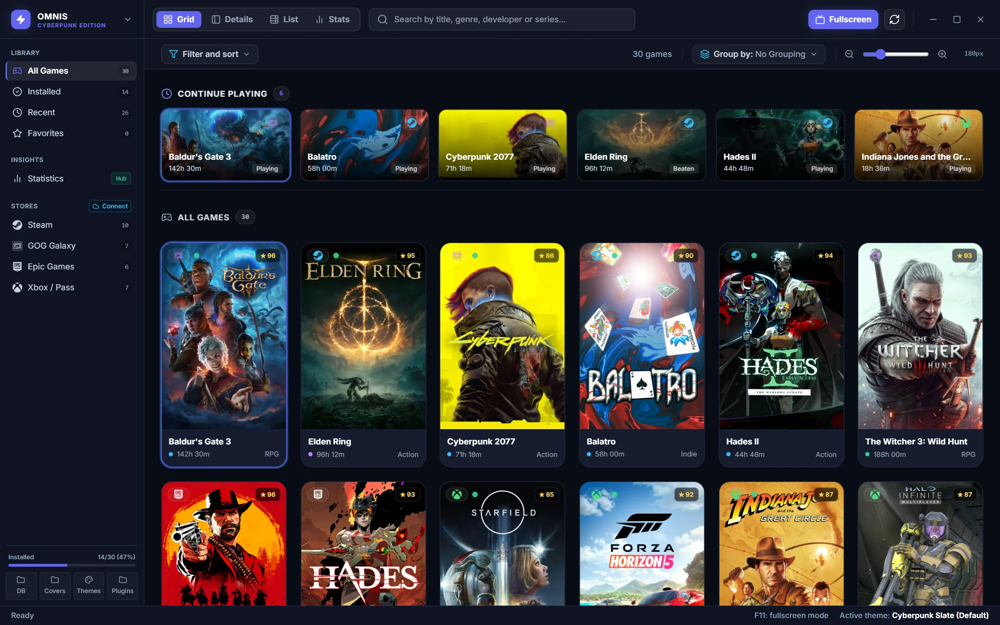
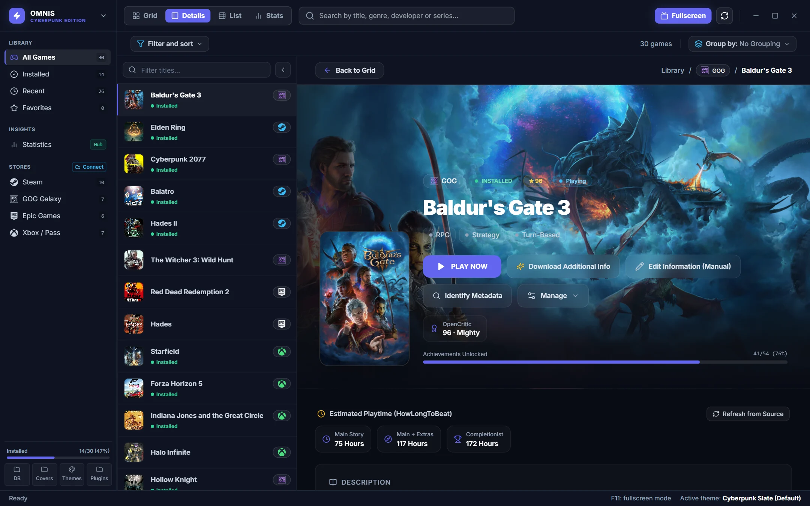
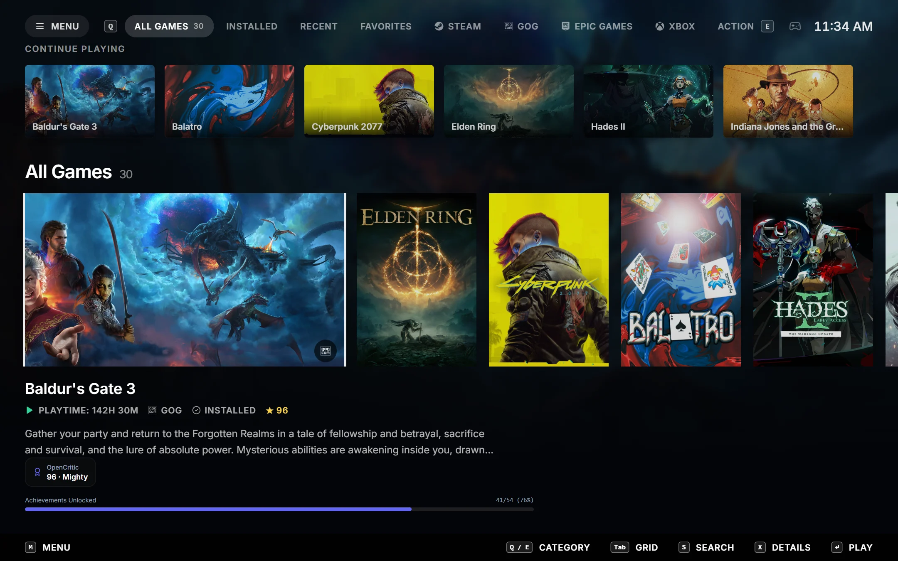
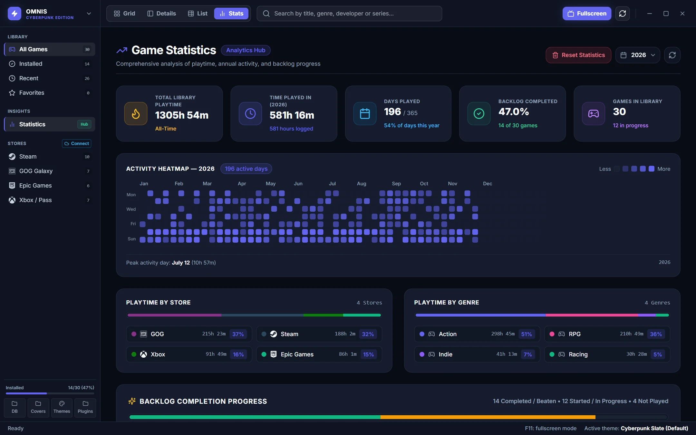
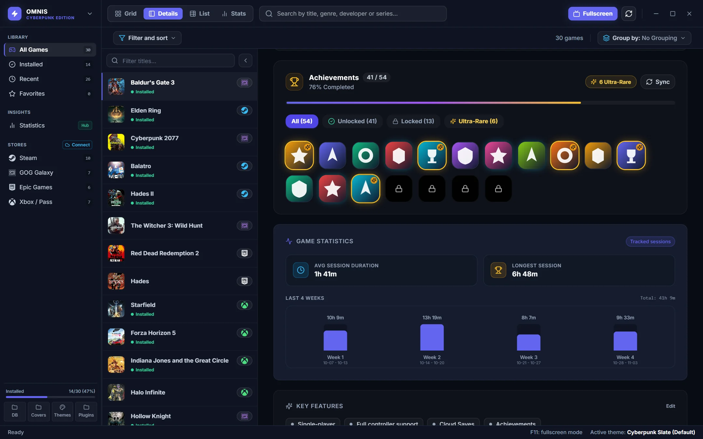

# Omnis

[](https://github.com/rinaldinie/omnis/actions/workflows/ci.yml)
[](https://github.com/rinaldinie/omnis/releases)
[](LICENSE)

> Modern, lightweight, open-source universal game launcher built in Rust.



---

## Overview

Omnis aggregates your PC gaming library across platforms into a single, cohesive, modern desktop and big-picture interface. It provides native process tracking via Windows Kernel Job Objects, offline-resilient metadata resolution, customizable themes, and full gamepad navigation.

### Key Highlights

- **Universal Library Aggregation**: Built-in integrations for Steam, Epic Games Store, GOG and Xbox / PC Game Pass (local scanners and cloud accounts), plus custom executables.
- **Robust Process Tracking**: Windows Kernel Job Objects track game processes and child trees accurately without relying solely on window handles.
- **Metadata Pipeline**: 6 built-in native providers (Steam Store, GOG, IGDB, SteamGridDB, OpenCritic, HowLongToBeat) with drag-and-drop source priority ranking, offline fallback, credential management, and manual candidate resolution.
- **Achievements**: Per-store achievement sync with local cache, automatic sync on game exit and on startup.
- **Statistics Dashboard**: Playtime analytics, activity heatmap, weekly charts and backlog progress.
- **Backup & Restore**: Native library backups with scheduling and rotation.
- **Playnite Import**: Import library, sessions and media from Playnite databases and backups.
- **Embedded SQLite Engine**: Local SQLite database with automatic migrations, FTS search, index optimizations and WAL mode.
- **Multi-View Interface**: Grid view with dynamic zoom, split details panel, and list view with sorting and dynamic grouping.
- **Fullscreen Mode**: Controller-first fullscreen experience with synthesized SFX and a virtual gamepad keyboard.
- **Themes & Localization**: Built-in themes with a slot-based theme API; UI available in English, Italian, French, German, Spanish and Japanese.
- **Modular Native Architecture**: Zero cold-start overhead with statically linked store integrations and built-in metadata providers, backed by the `omnis_sdk` contracts.
- **Auto-Update**: Signed in-app updates via the Tauri updater.

### Screenshots

| Game details | Fullscreen mode |
| :---: | :---: |
|  |  |
| **Statistics dashboard** | **Achievements** |
|  |  |

---

## Workspace Architecture

```
omnis/
├── crates/
│   ├── omnis_sdk/       # Plugin contracts, DTOs, events, settings schema, C-ABI (FFI)
│   ├── omnis_core/      # Engine: SQLite persistence, launcher, metadata, achievements, backup, plugin hosts
│   ├── omnis_tauri/     # Tauri v2 desktop shell
│   │   ├── src/         #   Rust: IPC commands and background services
│   │   ├── ui/          #   React 18 + TypeScript + Tailwind CSS frontend
│   │   └── themes/      #   Built-in themes
│   └── omnis_cli/       # Headless CLI management tool
├── plugins/
│   ├── omnis_plugin_steam/  # Steam scanner (VDF), cloud sync, achievements
│   ├── omnis_plugin_epic/   # Epic Games Store manifests, cloud sync, achievements
│   ├── omnis_plugin_gog/    # GOG Galaxy integration
│   └── omnis_plugin_xbox/   # Xbox Live & PC Game Pass integration
├── scripts/             # Release tooling (version bump, tagging, local update server)
└── .github/             # CI, release workflow, issue/PR templates
```

---

## Architecture: Store Integrations & Metadata Pipeline

Omnis uses a fully native, in-process architecture designed for zero cold-start latency, maximum reliability, and secure credential handling:

```
┌────────────────────────────────────────────────────────────────────────┐
│                       Omnis Desktop & CLI Shell                        │
├───────────────────────────────────┬────────────────────────────────────┤
│         Store Integrations        │     Native Metadata Pipeline       │
│  (Steam, Epic Games, GOG, Xbox)   │  (IGDB, SteamGridDB, OpenCritic,   │
│                                   │   HowLongToBeat, Steam, GOG)       │
├───────────────────────────────────┼────────────────────────────────────┤
│  • Local Manifest Scanners        │  • Reorderable Priority Ranking    │
│  • OAuth Cloud Synchronization    │  • Live Connectivity & Auth Badges │
│  • Job Objects Process Tracking   │  • Unified & Backward-Compat JSON  │
│  • SecretVault (DPAPI / Keyring)  │  • Offline Caching & Cover Scrape  │
└───────────────────────────────────┴────────────────────────────────────┘
```

### Store Integrations (First-Party Built-ins)

All store integrations live as dedicated workspace crates under [`plugins/`](plugins/):
- [`omnis_plugin_steam`](plugins/omnis_plugin_steam): Local VDF manifest detection, Steam Cloud sync, and Steam achievements.
- [`omnis_plugin_epic`](plugins/omnis_plugin_epic): Local `.item` manifest parsing, Epic Games account sync, and achievements.
- [`omnis_plugin_gog`](plugins/omnis_plugin_gog): GOG Galaxy local database scanning, OAuth token exchange, and cloud library sync.
- [`omnis_plugin_xbox`](plugins/omnis_plugin_xbox): Xbox Live / PC Game Pass integration, title history, and achievement synchronization.

**Design Benefits:**
- **Zero Cold-Start Overhead**: Compiles directly into the final desktop and CLI binaries without dynamic library loading or ABI negotiation.
- **Deep OS & Vault Wiring**: Direct access to `SecretVault` (hardware-backed DPAPI / OS Keyring), desktop OAuth protocol handlers, and Windows Kernel Job Objects for child-process lifecycle tracking.
- **Zero Setup**: All stores work immediately out of the box without downloading external packages or dependencies.

### Native Metadata Pipeline

Omnis includes **6 built-in native providers** for rich metadata, covers, playtime estimates, and critic scores:

| Provider | Supported Features | Credentials Required |
| :--- | :--- | :--- |
| **Steam Store** | Details, descriptions, genres, release dates, screenshots, hero banners | No (Public API) |
| **GOG** | Descriptions, covers, release dates, background artwork | No (Public API) |
| **IGDB** | Comprehensive game database, high-res artwork, developer/publisher, genres | Yes (Twitch Client ID & Client Secret) |
| **SteamGridDB** | High-res grids, hero banners, logos, and icons | Yes (SteamGridDB API Key) |
| **OpenCritic** | Critic average scores, recommendations, review tiers | Yes (RapidAPI Key) |
| **HowLongToBeat** | Live search & playtime estimates (Main Story, Main + Extra, Completionist) | No (Direct built-in scraper) |

#### Reorderable Priority Pipeline & Settings
- **Custom Priority Ordering**: Users can customize the evaluation order of metadata providers (e.g., prioritize SteamGridDB for covers, IGDB for descriptions, and OpenCritic for review scores) directly from **Settings → Metadata → Pipeline Priority**.
- **Credentials & Connectivity**: Each provider tab features direct developer portal links, credential testing, and real-time connectivity status badges.
- **Unified Settings Persistence**: Provider keys and pipeline configuration are persisted in `metadata_settings.json` and `pipeline_config.json` inside the application config directory.

---

## Prerequisites

- **Rust**: latest stable toolchain (pinned via [`rust-toolchain.toml`](rust-toolchain.toml), with `rustfmt` and `clippy`)
- **Node.js**: 22 LTS and `npm`
- **Operating System**: Windows 10/11 (with Microsoft Edge WebView2 runtime), Linux or macOS.
  Linux builds need the [Tauri system dependencies](https://v2.tauri.app/start/prerequisites/#linux).

---

## Getting Started

### 1. Build the Frontend

```bash
cd crates/omnis_tauri/ui
npm ci
npm run build
cd ../../..
```

### 2. Run the Application

```bash
# Debug mode
cargo run -p omnis_tauri

# Optimized release mode
cargo run -p omnis_tauri --release
```

### 3. Run the Checks

```bash
cargo clippy --workspace --all-targets -- -D warnings
cargo test --workspace
npm --prefix crates/omnis_tauri/ui run typecheck
```

These are the same checks run by CI on every push and pull request.

---

## Releasing

Releases are cut with the scripts in [`scripts/`](scripts), which bump the version in `Cargo.toml`, `tauri.conf.json` and `package.json`, then commit, tag and push:

```bash
npm --prefix crates/omnis_tauri/ui run release:minor
```

Pushing a `v*` tag triggers the [release workflow](.github/workflows/release.yml), which builds signed installers for Windows, Linux and macOS. See [CHANGELOG.md](CHANGELOG.md) for the release history.

---

## Contributing

Contributions are welcome. Please read [CONTRIBUTING.md](CONTRIBUTING.md) for the development workflow and coding standards, and [SECURITY.md](SECURITY.md) for reporting vulnerabilities.

---

## License

This project is licensed under the [MIT License](LICENSE).
