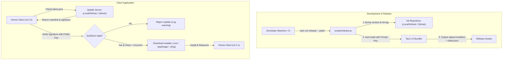

# Design Spec: Online Auto-Updater & Automated Versioning System for Omnis

- **Date**: 2026-10-23
- **Status**: Approved for Planning
- **Component Target**: `crates/omnis_tauri`, `crates/omnis_tauri/ui`, `.github/workflows`, `scripts/`
- **Tauri Target**: Tauri v2.1+

---

## 1. Executive Summary & Goals

Omnis Game Library requires a production-grade, secure, and user-friendly online auto-update mechanism alongside an automated version synchronization and release workflow.

### Primary Objectives
1. **Automated Version Synchronization**: A single command (`npm run release -- <bump>`) that atomically updates versions across `Cargo.toml`, `crates/omnis_tauri/tauri.conf.json`, and `crates/omnis_tauri/ui/package.json`, generates semantic git commits, and creates annotated git tags.
2. **Cryptographically Signed Updates**: Native integration with `@tauri-apps/plugin-updater` and `tauri-plugin-updater` using Ed25519 key signatures to prevent unauthorized or corrupted binaries.
3. **Non-Intrusive In-App UX**: Silent background check at startup with non-blocking toast notifications, complemented by an interactive "Verifica Aggiornamenti" control panel in Settings with real-time download progress and a one-click restart trigger.
4. **Staged Deployment Architecture**:
   - **Phase 1 & 2 (Staging / Internal)**: Deployment and testing via a local HTTP server and internal Local/GitHub Git instance (`https://github.com/rinaldinie/omins.git`).
   - **Phase 3 (Production Online)**: Seamless transition to GitHub Releases (`https://github.com/rinaldinie/omins.git`) powered by multi-platform GitHub Actions.
5. **Comprehensive Operator Guide**: A clear reference manual (`docs/RELEASE_GUIDE.md`) documenting all operational commands, key handling, and testing steps.

---

## 2. Architecture & Security Model



### 2.1 Cryptographic Key Infrastructure
- **Algorithm**: Ed25519 (Tauri standard signer).
- **Public Key**: Embedded directly in `crates/omnis_tauri/tauri.conf.json` under `plugins.updater.pubkey`. It is distributed publicly with the application binary.
- **Private Key**: Generated once via `npx tauri signer generate`.
  - **Local Development**: Stored securely in a local configuration file (e.g., `~/.omnis/tauri.key` or `.env.local` which is strictly included in `.gitignore`).
  - **CI / GitHub Actions**: Stored as a repository secret `TAURI_SIGNING_PRIVATE_KEY` (with optional `TAURI_SIGNING_PRIVATE_KEY_PASSWORD`).

### 2.2 Endpoint Manifest (`latest.json`)
The update manifest specifies release metadata and platform-specific signatures:
```json
{
  "version": "0.2.1",
  "notes": "Omnis v0.2.1 Release: Fullscreen Mode improvements, controller polish, and bug fixes.",
  "pub_date": "2026-10-23T12:00:00Z",
  "platforms": {
    "windows-x86_64": {
      "signature": "...",
      "url": "https://.../Omnis_0.2.1_x64-setup.nsis.zip"
    },
    "linux-x86_64": {
      "signature": "...",
      "url": "https://.../omnis_0.2.1_amd64.AppImage.tar.gz"
    },
    "darwin-x86_64": {
      "signature": "...",
      "url": "https://.../Omnis.app.tar.gz"
    }
  }
}
```

---

## 3. Release Automation Script (`scripts/release.js`)

A cross-platform Node.js script located at `scripts/release.js` and registered in root and UI `package.json`:

```json
{
  "scripts": {
    "release": "node ../../scripts/release.js",
    "release:patch": "node ../../scripts/release.js patch",
    "release:minor": "node ../../scripts/release.js minor",
    "release:major": "node ../../scripts/release.js major"
  }
}
```

### Script Execution Flow
1. **Pre-flight Checks**:
   - Ensures working git tree is clean (warns if untracked or uncommitted changes exist, with `--force` bypass).
   - Validates that current branch is `main` (or user confirms release on feature branch).
2. **Version Resolution**:
   - Reads current canonical version from root `Cargo.toml` (`[workspace.package].version`).
   - Computes next semantic version according to argument (`patch`, `minor`, `major`) or explicit SemVer string (e.g., `0.2.5`).
3. **Atomic File Mutation**:
   - Root `Cargo.toml`: updates `[workspace.package] version = "<NEW_VERSION>"`.
   - `crates/omnis_tauri/tauri.conf.json`: updates `"version": "<NEW_VERSION>"`.
   - `crates/omnis_tauri/ui/package.json`: updates `"version": "<NEW_VERSION>"`.
   - Runs `npm install --package-lock-only` in `crates/omnis_tauri/ui` to keep `package-lock.json` synchronized.
4. **Git Operations**:
   - Stages the modified configuration files: `git add Cargo.toml crates/omnis_tauri/tauri.conf.json crates/omnis_tauri/ui/package.json crates/omnis_tauri/ui/package-lock.json`.
   - Commits with standard convention: `git commit -m "chore(release): v<NEW_VERSION>"`.
   - Creates annotated git tag: `git tag -a v<NEW_VERSION> -m "Release v<NEW_VERSION>"`.
5. **Optional Deployment Actions**:
   - `--build`: triggers local `tauri build` with update signature outputting to `dist-release/`.
   - `--push`: automatically executes `git push && git push --tags`.

---

## 4. Tauri Configuration & Plugin Integration

### 4.1 Backend (`crates/omnis_tauri`)
1. **Dependencies (`crates/omnis_tauri/Cargo.toml`)**:
   ```toml
   [dependencies]
   tauri-plugin-updater = "2"
   ```
2. **Registration (`crates/omnis_tauri/src/main.rs`)**:
   ```rust
   tauri::Builder::default()
       .plugin(tauri_plugin_updater::Builder::new().build())
       // ... existing plugins and setup
   ```
3. **Permissions (`crates/omnis_tauri/capabilities/default.json` or `tauri.conf.json`)**:
   Add `updater:default` capability to allow UI invocation of check, download, and install APIs.

### 4.2 Configuration (`crates/omnis_tauri/tauri.conf.json`)
```json
{
  "plugins": {
    "updater": {
      "pubkey": "<ED25519_PUBLIC_KEY>",
      "endpoints": [
        "https://github.com/rinaldinie/omins/releases/latest/download/latest.json",
        "https://github.com/rinaldinie/omins/releases/latest/download/latest.json"
      ]
    }
  }
}
```

---

## 5. Frontend UI & UX Integration

### 5.1 React Hook: `useAppUpdater` (`crates/omnis_tauri/ui/src/hooks/useAppUpdater.ts`)
Encapsulates state machine for updates:
- **States**: `idle` | `checking` | `upToDate` | `available` | `downloading` | `readyToInstall` | `error`
- **Properties**:
  - `currentVersion: string`
  - `availableVersion: string | null`
  - `releaseNotes: string | null`
  - `downloadProgress: { downloadedBytes: number; totalBytes: number; percentage: number } | null`
  - `error: string | null`
- **Actions**:
  - `checkForUpdates(silent: boolean): Promise<boolean>`
  - `downloadAndInstall(): Promise<void>`
  - `relaunchApp(): Promise<void>`

### 5.2 Startup Flow (`App.tsx`)
- After initial app mounting and library load (delay: 4 seconds), `checkForUpdates(silent: true)` is executed in background.
- If an update is found:
  - Emits non-blocking bottom-right session toast: *"Aggiornamento vX.Y.Z disponibile"*.
  - Displays a visual status indicator (accent badge) on the Settings icon in TopBar and Fullscreen menu.
- If no update or network failure during silent check: suppresses errors completely to ensure seamless offline gaming.

### 5.3 Settings Panel (`GeneralSettingsTab.tsx`)
A dedicated section in Settings:
- Displays current app version with a badge.
- Interactive button **"Verifica Aggiornamenti"**.
- Displays release notes when available.
- Real-time progress bar when downloading: `XX MB / YY MB (ZZ%)`.
- Clear call-to-action button when ready: **"Riavvia per completare l'aggiornamento"**.

---

## 6. Testing Strategy & Dual-Target Deployment

### Phase 1: Local Simulation Testing
1. Generate Ed25519 keys via `tauri signer generate`.
2. Configure `pubkey` in `tauri.conf.json`.
3. Build base release version `0.2.0`.
4. Run `npm run release -- patch` to produce version `0.2.1`.
5. Build `0.2.1` with `--build` to generate signed installers and `latest.json` into `dist-release/`.
6. Start a lightweight HTTP server (`npx serve dist-release -p 8080`) simulating the update endpoint.
7. Launch `0.2.0`, trigger check, verify signature validation, verify download progress bar, and confirm relaunch into `0.2.1`.

### Phase 2: Local/GitHub Staging Verification
1. Push release commit and tag to `https://github.com/rinaldinie/omins.git`.
2. Attach `latest.json` and installer assets to the Local/GitHub repository release.
3. Verify client pulls from local LAN Local/GitHub server and updates cleanly.

### Phase 3: GitHub Online Production
1. Push git commits and tags to `https://github.com/rinaldinie/omins.git`.
2. Store `TAURI_SIGNING_PRIVATE_KEY` in GitHub Secrets.
3. Enhance `.github/workflows/release.yml` with Tauri Updater build flags and signature integration.
4. Verify multi-platform automated release on GitHub with signed artifacts and live auto-updating.

---

## 7. Operator Documentation: `docs/RELEASE_GUIDE.md`

A standalone markdown guide will be authored and maintained in `docs/RELEASE_GUIDE.md`, detailing:
- Key generation and safe backup.
- Command cheat-sheet:
  ```bash
  npm run release -- patch    # Bugfixes & minor enhancements (0.2.0 -> 0.2.1)
  npm run release -- minor    # New features (0.2.0 -> 0.3.0)
  npm run release -- major    # Breaking changes (0.2.0 -> 1.0.0)
  ```
- Local staging test commands.
- Local/GitHub and GitHub push instructions.
- Troubleshooting common issues (signature failure, firewall/SSL blocking, offline behavior).
